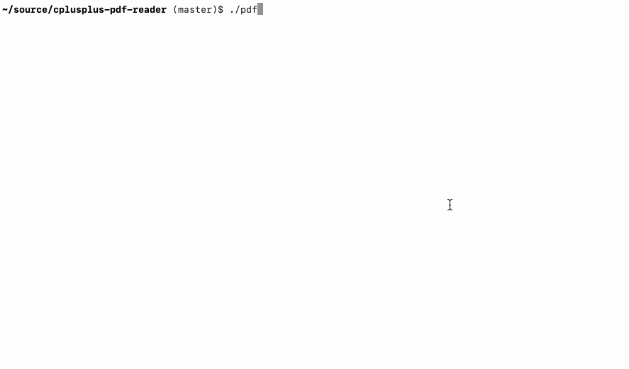

# C++ PDF Reader

A PDF-to-text converter I wrote in 1998 for a search engine called Alkaline. I needed to extract text for indexing without requiring separately installed libraries.



## The 1998 Original

The source was recovered from a backup, with a verified date of **December 26, 1998**. It is preserved unchanged in [`original/`](original/), including the Visual C++ 6 project files, support libraries, and bundled zlib source.

The goal was to read PDF files and convert them to text on the console. Give it a PDF filename, and it attempted to print document metadata, page text, and bookmark titles.

I was learning the PDF format by implementing a parser from Adobe's published PDF Reference. The source even cites a page number for stream filters. [Adobe's PDF history](https://www.adobe.com/accessibility/pdf.html) dates the public specification to 1993. This converter predates tagged PDF, introduced in 2001: it extracts text from page drawing commands rather than a tagged reading order. PDF became an ISO standard in 2008.

### What It Implemented

- PDF 1.0, 1.1, and 1.2 headers.
- Classic cross-reference tables, trailers, and indirect object lookup, with an attempt to follow incremental updates through `/Prev`.
- Dictionaries, arrays, names, numbers, booleans, null values, and literal and hexadecimal strings.
- Document metadata such as author, title, subject, keywords, creator, producer, and dates.
- Page-tree traversal and basic extraction from PDF text operators.
- Flate-compressed content streams using the bundled zlib implementation.
- Outline traversal, printing nested bookmark titles.

The program bundled my string, vector, hash-table, date, and MD5 helpers, together with zlib. Encryption was a stub.

### What It Did Not Do

It did not render pages or images, reconstruct layout, or reliably interpret font encodings. Other stream filters were described in comments but not implemented. The document-structure and page-description classes were largely scaffolding.

The surviving parser also has incomplete handling of stream lengths, filter arrays, line endings, and some text operators. It was an unfinished converter for simple PDFs of its period, not a general-purpose PDF implementation.

The files `original/pdf.tmp` and `original/pdf.new` appear to be compressed and decompressed stream artifacts, not complete sample PDF documents.

## Modern Port

A C++17 port lives in `src/`. It keeps the original parsing approach, replacing obsolete compiler interfaces and storage with standard-library types.

The port uses system zlib instead of the bundled 1990s copy.

### Build and Run

Requirements: a C++17 compiler, `make`, and zlib headers/library. On macOS, these are available with the Command Line Tools.

```sh
make
./pdf-reader fixtures/legacy-uncompressed.pdf
./pdf-reader fixtures/legacy-flate-crlf.pdf
./pdf-reader --help
```

The Makefile defaults to `clang++`; use `make CXX=g++` for GCC.

Output contains document metadata, `Page N:` text, and `Outlines:` titles. Missing metadata is empty; dates are printed as stored.

Exit status is `0` on success, `1` for file or parsing errors, and `2` for incorrect arguments. Errors go to stderr; failed conversions produce no partial report.

### Architecture

| Historical responsibility | Modern implementation |
| --- | --- |
| `PDFObjects`, primitive parsing | Typed values, recursive parser, `std::string`, `std::vector`, `std::map` in `src/PDFObjects.*` |
| `PDFObjectRef` and cross-reference lookup | Object/generation references and newest-first classic xref indexing in `src/PDFFile.*` |
| `PDFFile` document processing | Object cache, trailer, metadata, page-tree and outline traversal in `src/PDFFile.*` |
| `StreamToString` | Content-token interpreter in `src/PDFObjects.cpp` |
| Bundled zlib / `ZlibEngine` | Bounded, checked system-zlib `inflate`, with RAII cleanup |
| Constructor-based CLI | Standard `int main`, explicit diagnostics and return codes |

### Supported Features

- PDF headers 1.0, 1.1, and 1.2; classic xref tables with multiple subsections and incremental `/Prev` chains. New entries, including free entries, mask older entries; generation numbers and object offsets are checked.
- Dictionaries, mixed arrays, booleans, null, signed integer/decimal numbers, names (including `#xx` escapes), and indirect references.
- PDF whitespace and comments; LF, CRLF, and CR line endings.
- Nested literal strings, standard escapes, octal escapes, escaped line continuations, and whitespace-separated / odd-length hexadecimal strings.
- Exact binary stream `/Length`, including indirectly referenced lengths. Leading whitespace and NUL bytes are preserved; embedded `endobj` or `endstream` bytes are not treated as delimiters.
- Uncompressed and `FlateDecode` streams, filter arrays/chains, absent/null decode parameters, and explicit `/Predictor 1`.
- Page `/Contents` streams and arrays, including an indirectly referenced array. Arrays are combined in order, preserving text state across streams.
- `BT`, `ET`, `Td`, `TD`, `Tm`, `Tj`, `TJ`, `T*`, `'`, and `"` text operators. Quotes move to the next line **before** showing text. `TJ` shows every string in order and ignores numeric kerning adjustments; it does not insert arbitrary spaces between fragments. `Td`/`TD` insert newlines, as in the original; `Tm` does not attempt geometric layout.
- The original `/Info` fields and recursively indented outline titles; UTF-16BE/LE metadata and outline strings with a BOM are converted to UTF-8.

### Limitations

- Encryption, xref streams, object streams, hybrid `/XRefStm` tables, catalog version overrides, and versions newer than PDF 1.2 are rejected.
- Only `FlateDecode` is supported. ASCIIHex/ASCII85, LZW, image filters such as DCT/JPEG, filter abbreviations, predictors other than 1, other decode parameters, and external-file streams are rejected.
- **Every active xref object and every stream is checked**, including streams not reached by the page walker. Consequently, a legacy document containing a JPEG-filtered image is rejected even if only its text was requested. Corrupt, truncated, or trailing-data Flate streams fail explicitly.
- Inline images (`BI`/`ID`/`EI`) and XObject invocation (`Do`, including Form XObjects) are rejected rather than silently skipping potentially textual content. Ordinary non-text graphics/state operators are ignored.
- This extracts decoded string **bytes**, not rendered glyphs. There is no font encoding, PDFDocEncoding conversion, `ToUnicode`/CMap processing, ligature handling, spacing reconstruction, column detection, or reading-order inference. Non-ASCII page text or custom font encodings may not be readable. Metadata without a UTF-16 BOM is also passed through as bytes.
- No image extraction, rendering, repair/scanning fallback, passwords, annotations, attachments, interactive forms, or accessibility/marked-content interpretation. Duplicate dictionary keys and inconsistent page counts are rejected rather than repaired.

### Resource Limits

Input files are limited to 64 MiB, individual streams and combined page content to 32 MiB, and cumulative decoded data and output to 64 MiB each. Parsing, nesting, and traversal limits are defined in `src/PDFObjects.h`. Invalid lengths, offsets, and reference cycles produce errors.

### Sample Documents

The two PDFs in `fixtures/` demonstrate uncompressed and Flate-compressed content. Both produce `fixtures/expected.txt`.

## License

[MIT License](LICENSE). Bundled third-party code, including the historical zlib source in `original/zlib/`, retains its own license notices.
